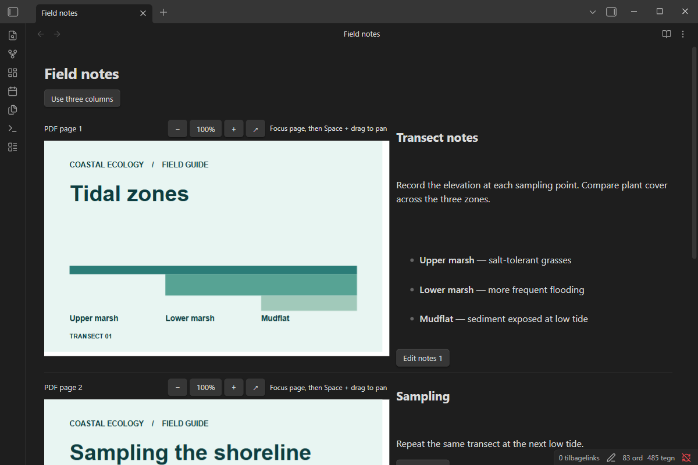

# Pagebound Notes

Read a PDF alongside page-linked Markdown notes in Obsidian Live Preview.

[Reading View](assets/reading-view.png) · [Three-column layout](assets/three-columns.png)

## Install from GitHub

1. Download `main.js`, `manifest.json`, and `styles.css` from the release.
2. Put the three files in `.obsidian/plugins/pagebound-notes/` in your vault. Substitute your vault's configuration folder if you changed it.
3. Open Settings → Community plugins and enable Pagebound Notes.

Target: desktop Obsidian 1.12.7 or later. Use a separate vault to try a development build.

## Use

In a Markdown note in Live Preview, run **Insert PDF notes** and select a PDF from the vault. Switch between two and three columns with the button above the PDF. Click a note or its Edit button to write Markdown. Changes use the note's undo history. Pinch on a touchpad over a PDF page to zoom around the pointer. Each page has its own zoom controls and a button to open the original PDF. To pan a zoomed page, scroll within it, drag with the middle mouse button, or focus the page and hold Space while dragging. Existing PDF text can be selected and copied. Scanned PDFs are displayed without OCR.

The source uses a vault wikilink, page headings and HTML comment markers. Keep the markers intact when editing in Source Mode. Page associations use the physical PDF page number. If you reorder the PDF, move the notes to match. Reading View shows the slides alongside their notes. The Markdown notes remain readable after disabling the plugin.

PDF files are read from the local vault. Pagebound Notes uses no accounts, network services or telemetry.

## Develop

Use Node.js 24. Run `npm ci`, `npm run check`, `npm test`, and `npm run build`. Build output is in `dist/`.

The project is MIT-licensed. Bundled PDF.js code is available under Apache-2.0. The bundle preserves upstream license notices.

## Export slides and notes

Use Obsidian’s built-in **Export to PDF** command. The export includes full slides and their corresponding notes.
